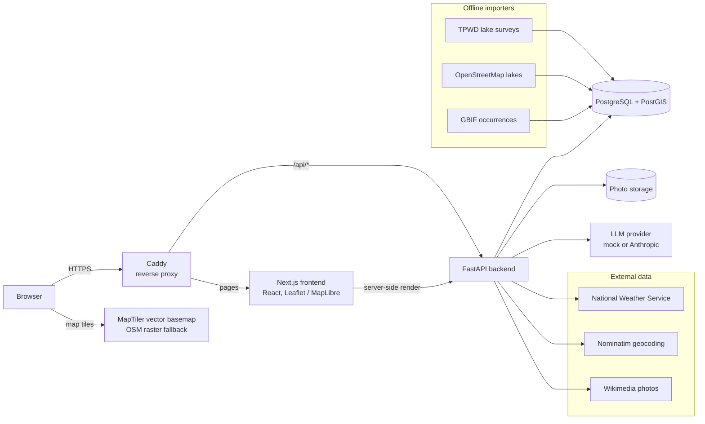

# FishEye

[](https://github.com/pwzerus/FishEye/actions/workflows/ci.yml)

**Find fishable water near you, wherever you are, and know what to do when you get there.**

FishEye is a map-first fishing assistant for beginners. Open the map (or search
a city, lake or ZIP code) and it shows the lakes around you. Pick one and it
tells you what lives there, whether you can get to the water legally, what the
weather means for fishing today, and how to catch the fish you're after, with
every claim traced back to an official source.

It is a portfolio project, built end to end by one engineer: data pipelines,
API, scoring engine, grounded LLM features with evals, web app, Docker and CI.

## The problem

Someone new to fishing, or someone who just moved or is travelling, asks the
same three questions: *where is the water near me, can I fish there, and how?*
Today the answers are spread over a state agency's survey reports, a separate
stocking site, a weather forecast, OpenStreetMap, forum posts and YouTube.
None of them answers "near me", and most assume you already know the jargon.

FishEye pulls those sources into one place, organised around **where you are**:

1. **Find water nearby.** Your location (or a search) centres the map; nearby
   lakes load for whatever is in view. Every named lake in all 50 states and
   DC comes from OpenStreetMap (about 65,000), with lakes verified by state
   agencies on top: 160 from Texas Parks & Wildlife (TPWD), Georgia WRD's
   access sites, and in California every lake CDFW stocks.
2. **Know what you'll find, and where to get in.** Species come from agency
   surveys, stocking schedules and plans, and state fish records, each as a
   fact in FishEye's own words with a link to the source; TPWD's
   poor-to-excellent ratings and public boat ramps are shown with "Data:
   TPWD". Species *reported* in museum, agency and citizen-science records
   (GBIF, USGS) are shown as exactly that. Entrances from OpenStreetMap are
   labelled unverified, and a lake on public land (PAD-US) says so.
3. **Know when and how.** A spot score and morning/evening bite windows from
   the National Weather Service forecast, reviewed guides for nineteen species and an angler's handbook,
   and a Q&A over those guides that answers in plain language and cites them.

Lakes cover every state; official data covers Texas, Georgia and California,
and fishing rules are written for those three; the data model, importers,
guides and Ask are per-state (see [Roadmap](#roadmap), ADRs 0027–0028 and
0034–0036). Every data source, its terms and its credit is listed in
[`docs/data-sources.md`](docs/data-sources.md); which OpenStreetMap water
counts as a lake is the skill [`fisheye-osm-lakes`](docs/skills/fisheye-osm-lakes/SKILL.md).

## What it does

| Page | |
|---|---|
| **Map** (`/map`) | Locate me / search; lakes in view, with verified lakes always kept and the rest ranked by size when a view is crowded; a lake panel with TPWD's profile and fishing ratings, species with their evidence, public boat ramps, weather, bite windows and an AI explanation of the ranking. |
| **Fish guides** (`/fish`) | Nineteen species: how to recognise each one (look-alikes compared on the same features), habitat and habits, where and when, bait and why it works, lures, beginner tackle setups, cleaning and eating. Plus a 75-card angler's handbook: baits, lures, tackle, knots, casting and playing a fish, weather and water, staying safe, the licence, telling fish families apart, timing, and releasing, cleaning and cooking a catch. Every section cites its sources. |
| **Ask** (`/ask`) | Free-text questions, in English or Chinese ("how do I tell white bass from hybrid striped bass?", "鲈鱼怎么钓") answered with the matching guide passages and their sources, free and with no account. An empty answer says which kind it is: not a fishing question, a fish with no guide, or a fishing question the guides don't answer. Signed in, an AI summary of those passages, 3 a day. |
| **Community** (`/community`) | Accounts and catch pins with photos, with moderation tools for admins. |

## Architecture



**Backend** (Python 3.11, FastAPI, SQLAlchemy 2, Alembic, Pydantic)

- `data_import/`: TPWD lake pages and survey reports (a polite, robots.txt-checked
  fetch to a local cache, then an offline import), TPWD's boat-ramp dataset,
  statewide OSM lake import, GBIF occurrence import, demo seed.
- `services/scoring.py`: the spot score. Each factor is a value *or* "no
  data", never a silent zero; missing factors are dropped and the rest
  renormalised, and the result carries a confidence.
- `services/weather_adapter.py`, `geocoding.py`, `species_photos.py`: every
  external API sits behind an adapter with a timeout, one retry, a circuit
  breaker and caching, so a slow upstream degrades one panel, not the page.
- `services/ai_advisor.py`, `services/rag/`: the LLM features (below).
- `db/spatial.py`: radius and viewport queries. PostGIS `ST_DWithin` on
  PostgreSQL; the same API on SQLite for zero-setup development.

**Frontend** (Next.js 16, React 19, TypeScript): server-rendered pages,
a MapLibre vector basemap (MapTiler style, with its airport icons hidden
so rural airstrips don't drown out the lakes) and Leaflet layers on top, falling back to
OpenStreetMap raster tiles when no key is configured; a US states layer;
Vitest + Testing Library.

**Infrastructure**: Docker Compose runs the whole stack with one command;
a production layer adds Caddy (automatic HTTPS) for a single server.
GitHub Actions runs lint and tests (backend on SQLite *and* PostGIS),
a production frontend build, and a Docker build with smoke tests on every push.

## Engineering highlights

- **LLMs on a leash.** The model only writes prose. Citations, links and
  facts come from the server, and every reply is validated before anyone
  sees it: it must cite passages it was actually given, may not contain a
  URL, may not name a fish its sources don't mention, and may not contain a
  number (hook size, line weight) that isn't in its sources. Failures retry
  once, then fall back to quoting the guide verbatim, labelled as such.
- **Retrieval measured, not assumed.** Guide Q&A is BM25 with species
  routing, plus an optional local embedding model (multilingual-e5-small,
  int8, CPU) that only re-ranks: measured on this corpus, its similarity
  scores can't tell fishing from off-topic questions, so rules keep that
  decision — but *which of two things* a question is closer to is something
  the model answers well, and that is how "bass" the fish is told from
  "bass" the guitar (ADR 0026). Judged on 98 beginner questions (hit@4 99%,
  MRR 0.88), 28 in Chinese, 34 on the newest topics, 80 rephrasings (30
  written after the tuning, 90%) and 33 questions using a fish name in its
  everyday sense, with a "wrong fish" check. The same eval caught the
  on-topic gate letting 14 of 21 deliberately tricky off-topic questions
  through ("how to tie a tie"); rebuilt, it lets 1 of 30 through and admits
  every fishing question that names no fish. The eval runs in the test
  suite, so a regression fails CI.
- **Rules belong to a state.** How to catch a fish is the same everywhere; a
  licence, a limit or a bait rule is a state's. Passages that state a rule are
  tagged with their state and shown only there (Texas, Georgia and California so far),
  each state searching its own index; anyone in
  another state is told the rules aren't written yet and pointed to their
  own agency, instead of being given another state's as if they were theirs
  (ADRs 0027, 0028).
- **The model is optional.** Every question is answered by search alone,
  with sources and no model call. A written AI summary is an extra step for
  signed-in accounts, 3 a day, reserved atomically before the call and given
  back if the model fails or the answer came from cache. Off-topic questions
  never reach the model.
- **Honest data.** Confirmed, reported and map-only lakes are separate tiers,
  enforced in the scoring engine and the AI checks, not just in the UI.
  Public access comes only from official sources (TPWD's ramp dataset, or
  hand-checked), never geocoded from driving directions, because a wrong pin
  labelled "public access" sends someone onto private land. When the import
  can't tell which of two same-named lakes TPWD means, it leaves the lake out
  and lists it, rather than guessing; and a survey sentence like "No White
  Crappie were collected" is not counted as evidence that they're there.
- **Built to be public.** Per-visitor request limits on every endpoint that
  spends something (model calls, the free geocoder's one-a-second quota,
  weather lookups), plus a daily total on the model endpoints that bounds
  the bill however many addresses a script uses. Behind the proxy, the
  visitor's real address is what's counted, not the proxy's.
- **Runs without keys.** A mock LLM provider with injectable failures,
  keyless weather (NWS) and OpenStreetMap tiles mean a clean clone works
  with `docker compose up`, and the failure paths are tested, not just the
  happy path.
- **Decisions written down.** 35 architecture decision records in
  [`docs/adr/`](docs/adr/), each with the alternatives considered and the
  trade-off taken.

## Run it

Needs Docker (Docker Desktop on Windows or macOS). No API keys.

```bash
docker compose up --build
```

- Web app: http://localhost:3000
- API docs: http://localhost:8000/docs

This starts PostgreSQL with PostGIS, the API and the web app, and seeds three
demo lakes. Data is kept in Docker volumes between runs; `docker compose down
-v` wipes it and the next start re-seeds.

Optional settings (map tiles, a real LLM, Google sign-in) go in a `.env` file
next to `docker-compose.yml`: `cp .env.example .env` and fill in what you
have.

The demo lakes are a start. To load Texas (needs network, about 20 minutes
in all):

```bash
# every named lake, from OpenStreetMap
docker compose exec backend python -m app.data_import.osm_waterbody_import --state TX --save-raw /tmp/tx_osm.json
# TPWD's lake pages and survey reports, saved to a local folder (~15 min, polite)
docker compose exec backend python -m app.data_import.tpwd_fetch --out /tmp/tpwd_cache
# TPWD's Public Boat Ramps: download it as GeoJSON from
# https://gis-tpwd.opendata.arcgis.com/datasets/public-boat-ramps, then
docker compose cp BoatRamps_Public.geojson backend:/tmp/tpwd_cache/
docker compose exec backend python -m app.data_import.tpwd_statewide_import --cache /tmp/tpwd_cache
# once more, offline: folds OpenStreetMap's copies of the newly verified lakes into them
docker compose exec backend python -m app.data_import.osm_waterbody_import --state TX --from-file /tmp/tx_osm.json
```

Georgia (docs/adr/0029) has the statewide layer so far — every named lake
and OpenStreetMap's ramps and piers, plus GBIF species records — but no
agency-verified lakes yet:

```bash
docker compose exec backend python -m app.data_import.osm_waterbody_import --state GA --save-raw /tmp/ga_osm.json
docker compose exec backend python -m app.data_import.gbif_occurrence_import --state GA --osm /tmp/ga_osm.json --save-raw /tmp/gbif_ga_raw.json
```

California (docs/adr/0030) the same way, with `--state CA` and `ca_` file names.

Running without Docker: [`backend/README.md`](backend/README.md) and
[`frontend/README.md`](frontend/README.md). Putting it on a server:
[`docs/deploy-aws.md`](docs/deploy-aws.md).

## Repository layout

```
backend/    FastAPI app, importers, scoring, LLM + RAG, tests and evals
frontend/   Next.js app
docs/       product spec (PRD.md), ADRs, deployment, scoring rationale
docker-compose.yml        local stack
docker-compose.prod.yml   single-server production layer (with Caddyfile)
.github/workflows/ci.yml  CI
```

## Roadmap

**Next: public demo**
- Deploy on AWS: one EC2 server with Docker and Caddy, a domain and HTTPS.
- Then managed services: RDS PostgreSQL + PostGIS, photos on S3, images in
  ECR, secrets in SSM Parameter Store, logs and alarms in CloudWatch.

**AI**
- Turn on a real model behind a per-day spend cap, judged by the same eval
  set as the mock.
- Ship the embedding model in the Docker image (hybrid retrieval runs
  locally today; a deployment without the model is keyword-only).

**Coverage**
- Beyond Texas: the OSM and GBIF importers already take a state, and the
  agency-profile table is keyed by agency; each new state needs its own
  agency's lake data, ramps and regulations, surveyed first. The guides and
  Ask are already state-aware (ADR 0027): a state is a `Jurisdiction` in
  `knowledge/jurisdictions.py` plus rule passages tagged with its code.
- Texas lakes TPWD covers but the import couldn't place (15 of 175).
- More species guides; curated photos for the six added in ADR 0024; a
  casting topic in the handbook.
- Mobile-friendly map and offline-tolerant lake pages for use at the water.

## Status

Active development. Built by [Yifei Wang](https://github.com/pwzerus).
